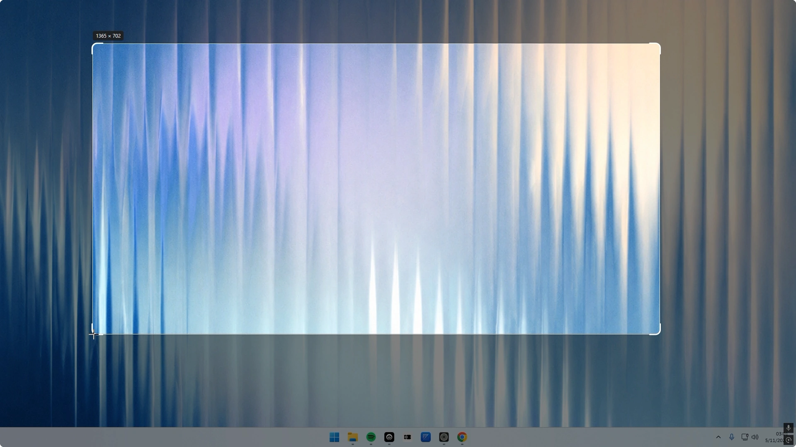

<p align="center">
  
</p>

<h1 align="center">Beauty Screenshot</h1>

<p align="center">Simple, beautiful screenshots for Windows.</p>

<p align="center">
  <a href="https://github.com/fabriciovla/BeautyScreenshot/releases/latest"></a>
  <a href="https://github.com/fabriciovla/BeautyScreenshot/actions/workflows/build.yml"></a>
  <a href="LICENSE"></a>
</p>

<p align="center">
  
</p>

## Features

- **Instant capture.** Press Print Screen, drag over what you want and it is ready.
- **Copy or save.** The capture goes to the clipboard or straight to your screenshots folder, your choice.
- **Corner thumbnail.** The capture rests for a few seconds in the corner of the screen, like on macOS.
- **Rounded corners.** Optional rounded corners with transparency, on the selection and the final image.
- **Stays out of your way.** Lives in the tray and can start with Windows.
- **English and Spanish,** following the Windows display language.

## Download

[Download BeautyScreenshot.exe](https://github.com/fabriciovla/BeautyScreenshot/releases/latest/download/BeautyScreenshot.exe)
and run it. It installs for the current user, without administrator rights, on Windows 10 and 11.

The file is not code-signed yet, so SmartScreen may show a warning: choose **More info → Run anyway**.

## How it works

Beauty Screenshot is a single WPF executable on .NET Framework 4.8, which ships with Windows, so it needs no runtime
of its own. A low-level keyboard hook catches Print Screen, a full-screen overlay freezes the screen while you select,
and the result is cropped, rounded and copied or saved as PNG.

```
src/     The app: overlay, thumbnail, toast, settings and installation
setup/   The setup executable, which carries the app inside
tools/   Build-time helper that draws the app icon
```

## Building

Requirements: Windows 10 or 11 and Visual Studio 2022 or its Build Tools (with MSBuild). No .NET SDK is needed.

```powershell
powershell -ExecutionPolicy Bypass -File build.ps1
```

This produces `BeautyScreenshot.exe` and `BeautyScreenshotSetup.exe` in the repository root.

## Contributing

Issues and pull requests are welcome. See [CONTRIBUTING.md](CONTRIBUTING.md).

## License

[MIT](LICENSE)
